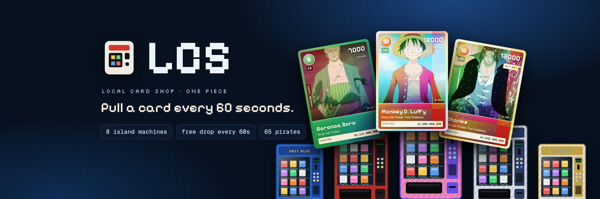

# LCS · local card shop

**Raise the sails. Pull a card every 60 seconds.**

LCS is a One Piece card vending machine game. Pull character cards from eight island machines, win the free drop that goes out every 60 seconds, and climb the crew leaderboard.

## Features

- **Eight island machines:** East Blue, Alabasta, Skypiea, Water 7, Thriller Bark, Marineford, Wano and Egghead, each with its own price, odds and expected value.
- **Vending animation:** a coin rolls into the slot, the machine shakes, a pack drops into the tray, and you open it and flip the card. Rare packs glow before you open them.
- **Free drop every 60 seconds:** the next machine in the rotation gives a card to one pirate on the leaderboard, weighted by crew value.
- **65 characters:** cards with cost, power, counter, crew and wanted-poster bounty, in six rarities (C, UC, R, SR, SEC, manga rare), plus a 1-in-15 gold alt art.
- **My crew:** your collection, with an inspect view, holo tilt and sell-back at 60%.
- **Music and sound:** an original chiptune sea shanty and sound effects, made with the Web Audio API.

## Running it

It's a single `index.html` file with no build step. Open it in a browser, or visit the GitHub Pages site.

## Credits

Fan-made project. Not affiliated with or endorsed by Eiichiro Oda, Shueisha, Toei Animation or Bandai. One Piece names and artwork belong to their owners. Character art via the One Piece Wiki. ฿ berries are play money.

Follow on X: [@LCSDrops](https://x.com/LCSDrops)
